# Single-cell methods on human bone marrow

An end-to-end single-cell RNA-seq analysis of healthy human bone marrow
mononuclear cells: quality control and annotation, a benchmark of seven
dimensionality-reduction methods, pathway and transcription-factor activity,
trajectory inference with RNA velocity, cell-cell communication, and
deconvolution of bulk RNA-seq with a model trained on the single cells.

Every stage is scored against something it was not given: the fixed cell-type
labels, held-out donors, a second resource or method, or an external dataset.
Negative results are reported alongside positive ones.

<a href="figures/annotate/annotate/umap_cell_type.png">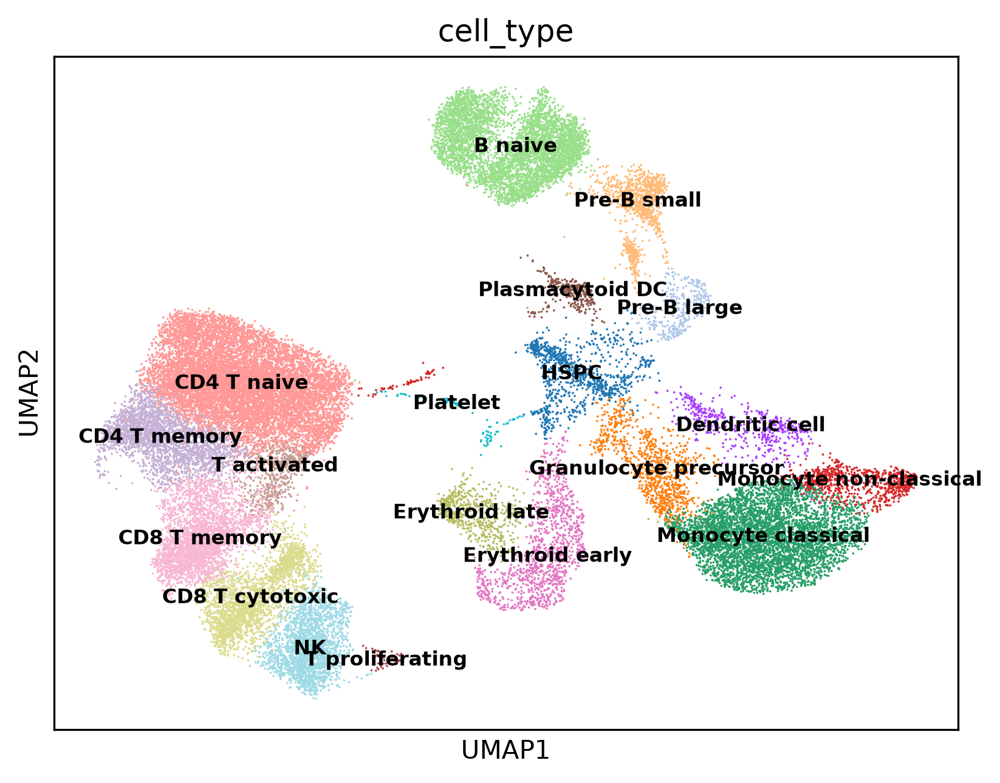</a><br><sub>38,430 cells from eight donors, annotated into 19 cell types</sub>

## Summary of findings

- **The donor batch effect is weak, and correcting it costs biology.** Seven
  embeddings score within 0.648–0.716 overall. scVI mixes donors best and
  preserves cell types worst; PCA was kept as the working representation.
- **The 19 cell-type labels are confirmed three times by methods that never saw
  them** — curated gene sets, signalling footprints and transcription-factor
  regulons (GATA1/KLF1 in erythroid cells, PAX5/SPIB in B cells, CEBPE in
  granulocyte precursors, STAT5A/B in NK cells).
- **One label is probably not a cell type.** "T activated" is 532 of 583 cells
  from one donor, rests on immediate-early stress genes, and failed every
  independent check.
- **Trajectory methods recover the progenitor side of the marrow and fail,
  predictably, on mature cells.** Stem-cell multipotency comes out as a number
  (fate entropy 0.80, no fate above 0.34); the monocyte lineage is recovered
  end to end in order, genes and velocity direction. Mature T and NK cells,
  which did not develop from these stem cells, are still given a confident but
  meaningless ordering — shown six independent ways.
- **RNA velocity is reliable in one lineage only.** Myeloid direction is
  correct in all four model fits; the erythroid direction is reversed in all
  four, and velocity confidence is highest exactly where the direction is
  wrong.
- **Most predicted cell-cell interactions restate known marker genes.** 80% of
  the 195 significant interactions come from two ligand families (HLA class I
  and S100A8/A9/A12). Only 74 reproduce in all eight donors; a single donor
  produces 307 interactions that no other donor finds.
- **A deconvolution model trained on these cells transfers to real bulk
  RNA-seq at the lineage level.** Sorted samples receive 0.77–0.98 of their own
  lineage; random mixtures of real profiles are estimated with concordance
  0.86–0.89 for myeloid, B and NK cells. Erythroid shares fail in mixtures.

## Data

Human Cell Atlas *Census of Immune Cells* bone marrow (Hay et al., 2018): eight
donors, one 10x Chromium lane each (MantonBM1–8). Spliced and unspliced counts
for RNA velocity were recomputed from the HCA BAM files. Sorted bulk RNA-seq of
13 healthy haematopoietic populations (GSE74246, Corces et al., 2016) was used
as an external test for deconvolution.

| step | cells | genes |
|---|---|---|
| merged, ≥ 200 genes per cell | 44,307 | 33,538 |
| after QC (5 MAD; mitochondrial cut only if also > 8%) | 40,103 | 20,568 |
| after Scrublet's own doublet calls | 39,955 | 20,558 |
| after per-donor top 4% doublet score | **38,430** | **20,455** |

Thresholds were adaptive because the data is shallow (median about 700 genes
per cell); a textbook `min_genes = 500` would have removed a third of it.
Scrublet's automatic threshold called only 148 cells (0.37%) against an
expected 3–6%. Those 148 were removed, and then the top 4% doublet score per
donor (1,525 cells). High-gene-count cells were kept and later turned out to
be early erythroid cells.

Leiden clustering (resolution 1.0, 21 clusters) was annotated into **19 cell
types** from marker genes, from CD4 T naive (10,765 cells) to T proliferating
(47). An independent CellTypist model agreed on 17 of 19; it has no
granulocyte-precursor class and did not separate T activated. The labels were
fixed at this point and never changed by any later stage.

<table><tr>
<td width="50%" valign="top"><a href="figures/qc/doublet_plot/doublet_checks.png">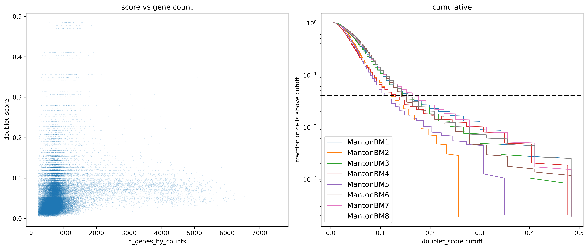</a><br><sub>Doublet score against genes per cell, and the share of cells above each cutoff per donor</sub></td>
<td width="50%" valign="top"><a href="figures/annotate/celltypist_check/umap_celltypist.png">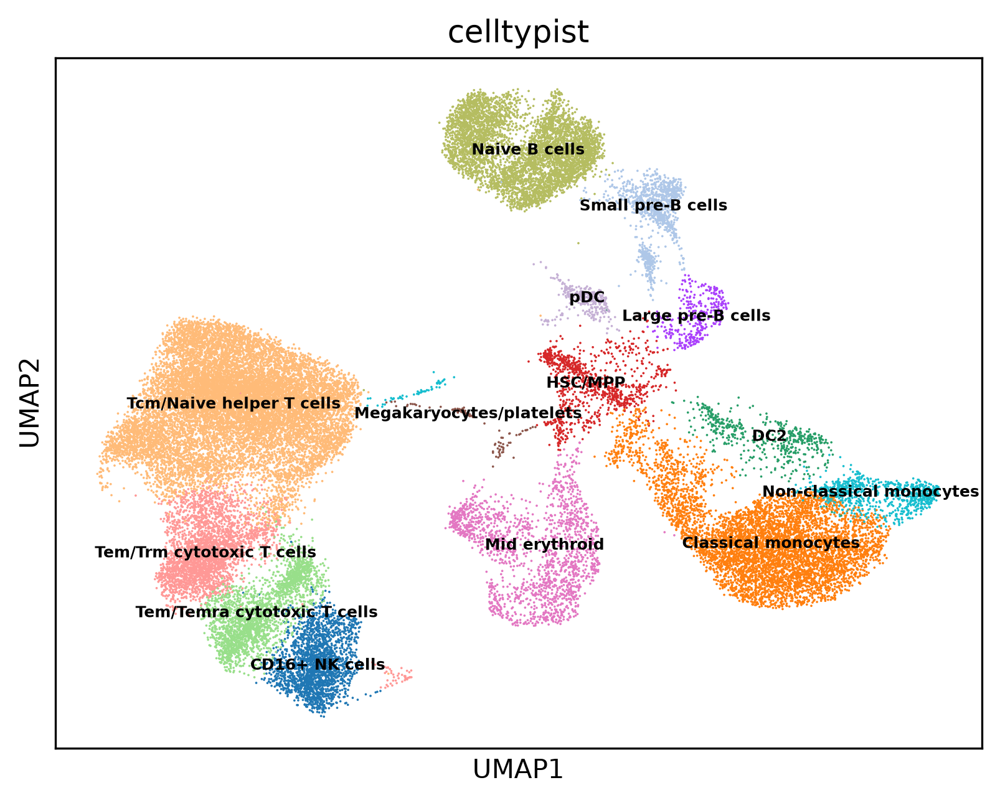</a><br><sub>Independent CellTypist labels on the same UMAP</sub></td>
</tr></table>

<a href="figures/annotate/annotate/dotplot_canonical.png">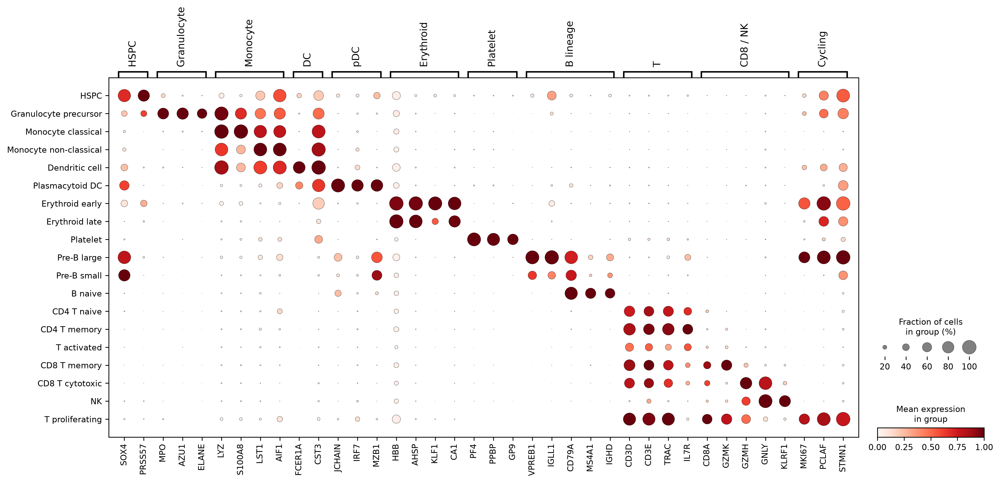</a><br><sub>Canonical markers across the 19 labels: each block lights up in its own row</sub>

QC and clustering figures: [`figures/qc/`](figures/qc/), [`figures/preprocess/`](figures/preprocess/), [`figures/cluster/`](figures/cluster/), [`figures/annotate/`](figures/annotate/)

## Results

### 1. Dimensionality-reduction benchmark

Seven embeddings, all 30 dimensions, with every downstream setting held
constant, scored with `scib-metrics`.

| embedding | biology | batch | total |
|---|---|---|---|
| Diffusion map on PCA | 0.760 | 0.649 | 0.716 |
| Diffusion map on scVI | 0.723 | 0.695 | 0.712 |
| Consensus NMF | 0.671 | 0.665 | 0.669 |
| scVI | 0.653 | 0.684 | 0.665 |
| **PCA** | **0.710** | 0.598 | 0.665 |
| Pearson residuals + PCA | 0.678 | 0.631 | 0.659 |
| GLM-PCA | 0.683 | 0.596 | 0.648 |

<table><tr>
<td width="50%" valign="top"><a href="figures/benchmark/benchmark_report/score_scatter.png">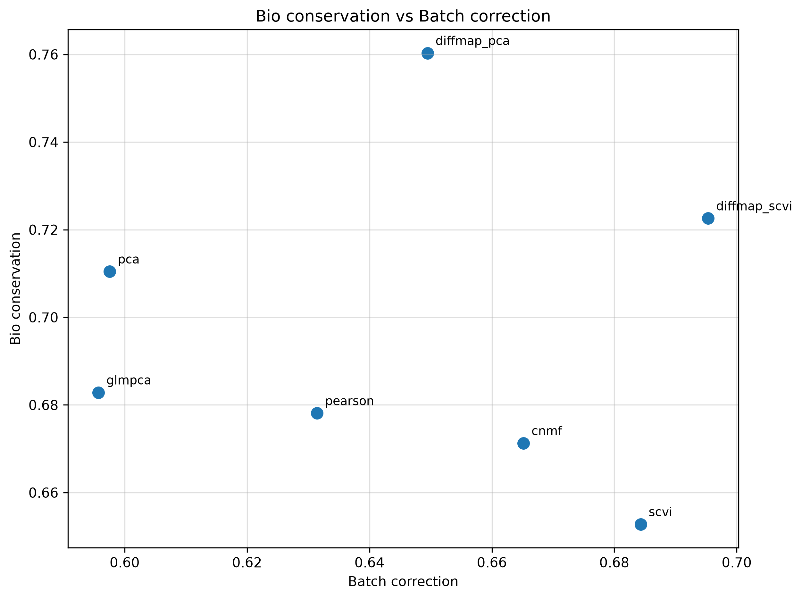</a><br><sub>Biology against batch correction: one is bought with the other</sub></td>
<td width="50%" valign="top"><a href="figures/benchmark/run_score/scib_results.png">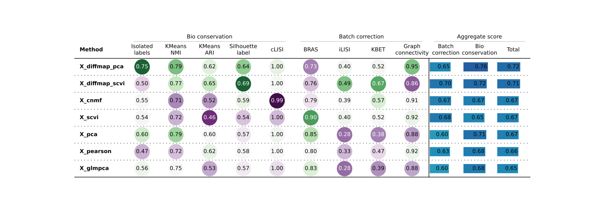</a><br><sub>Full scib-metrics table</sub></td>
</tr></table>

<table><tr>
<td width="50%" valign="top"><a href="figures/benchmark/benchmark_report/umap_grid_cell_type.png">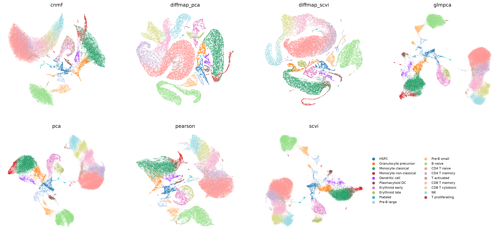</a><br><sub>Each embedding coloured by cell type</sub></td>
<td width="50%" valign="top"><a href="figures/benchmark/benchmark_report/umap_grid_donor.png">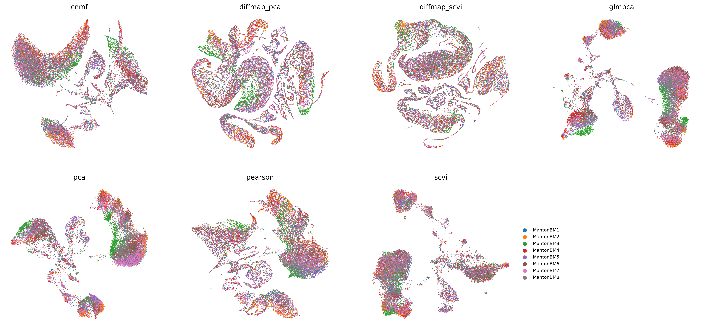</a><br><sub>Each embedding coloured by donor: donors mix everywhere</sub></td>
</tr></table>

All figures: [`figures/benchmark/`](figures/benchmark/) · tables: [`results/benchmark/`](results/benchmark/)

- Biology and batch mixing trade off along a straight line. scVI has the best
  batch mixing (BRAS 0.90) and the lowest cell-type agreement (ARI 0.46); on a
  dataset with little batch effect it removes biology.
- The diffusion maps top the table but are built on PCA and scVI, not
  alternatives to them, and fragment into 46–51 clusters at the shared
  resolution. They were used for trajectories instead.
- PCA's biology score is partly circular, since the labels came from PCA
  clusters; Pearson residuals and GLM-PCA land within 0.03 of it without that
  advantage. PCA is read as "no worse", not "better".
- Consensus NMF found what clustering cannot: five activity programmes
  (DNA replication, mitosis, histones, heat shock, inflammation) and three rare
  cell types absent from the labels — plasma cells, mast cells/basophils and
  macrophages (15–36 cells each).
- GLM-PCA diverges at its default penalty on this data; `penalty = 10` was
  needed.

### 2. Pathway and regulator activity

Over-representation on the top 200 markers per cell type, pre-ranked GSEA on the
full ranking (GO BP, KEGG, Reactome), and per-cell activity with decoupler
(PROGENy pathways, DoRothEA regulons A–C).

<a href="figures/pathway/pathway_report/heatmap_dorothea.png">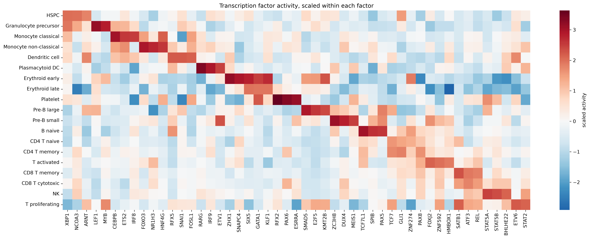</a><br><sub>Transcription-factor activity, scaled within each factor: one diagonal block per cell type</sub>

<table><tr>
<td width="50%" valign="top"><a href="figures/pathway/pathway_report/heatmap_progeny.png">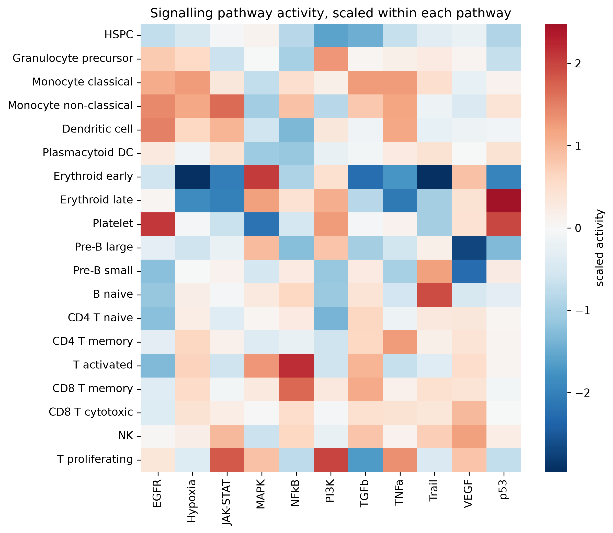</a><br><sub>Signalling-pathway activity by cell type (flat pathways removed)</sub></td>
<td width="50%" valign="top"><a href="figures/pathway/pathway_report/ora_vs_gsea_overlap.png">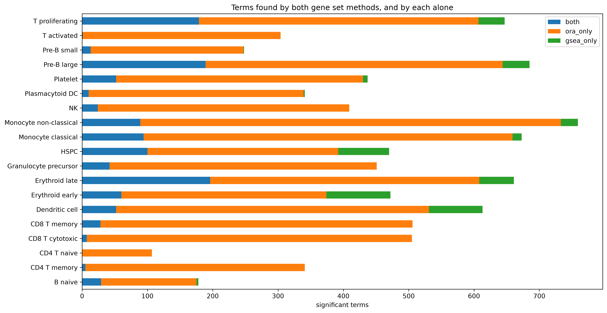</a><br><sub>Terms found by both gene-set methods and by each alone</sub></td>
</tr></table>

<a href="figures/pathway/pathway_report/umap_progeny.png">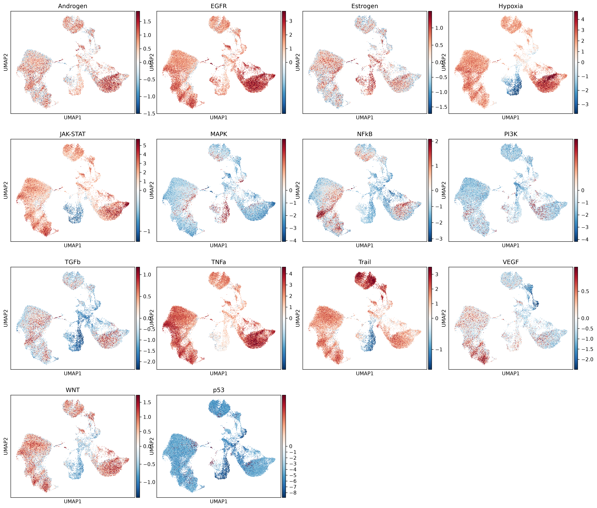</a><br><sub>Per-cell pathway activity: flat inside each cell type, changing between them</sub>

All figures: [`figures/pathway/`](figures/pathway/) · tables: [`results/pathway/`](results/pathway/)

- Transcription-factor activity, scaled within each factor, gives a clean
  diagonal: each cell type owns its textbook regulators. Unscaled, MYC ranks
  first in all 19 cell types — activity scores must be compared within a
  feature, never across features.
- p53 activity is lowest in exactly the four dividing populations, without the
  method being told which cells divide.
- Signalling activity follows cell identity: the per-cell maps are flat inside
  each cell type, a real negative result.
- GSEA adds the down side ORA cannot see (1,169 of 2,837 significant terms are
  negative). The two methods agree strongly where a cell type runs one large
  programme (Erythroid late 196 shared terms, Pre-B large 189) and not at all in
  the T compartment (CD4 T naive 0), because a one-versus-rest test of a T
  subset is mostly against other T cells.
- Three striking hits dissolved on reading their genes: KEGG
  neurodegeneration maps are respiratory-chain genes, a telomerase/Cajal-body
  term is the CCT chaperonin, and skin-barrier terms rest on one or two genes.
- Two of the three cell types found by consensus NMF are confirmed by gene-set
  catalogues (plasma cells, macrophages); mast cells rest on markers alone.
- The stem/progenitor population (HSPC) has no distinctive regulator or
  programme: its identity genes (CD34, AVP, CRHBP, SPINK2) belong to no
  catalogue. This recurs in every later catalogue-based method.

### 3. Trajectory inference and RNA velocity

PAGA, Palantir and CellRank on diffusion maps, a principal tree (scFates), and
RNA velocity (velocyto + scVelo, whole sample and progenitor-only). Mature T,
NK, B and monocyte cells were deliberately kept in, to test whether the methods
can tell collected cells from cells developing in the sample.

<table><tr>
<td width="50%" valign="top"><a href="figures/trajectory/paga_topology/paga_topology_diffmap_pca.png">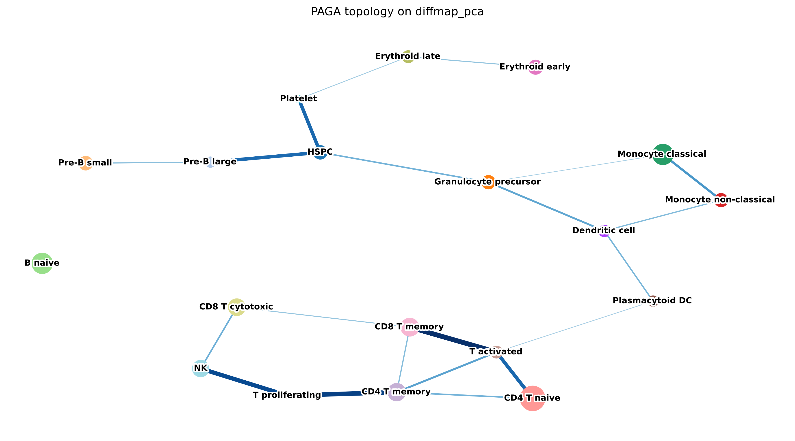</a><br><sub>PAGA connectivity between cell types</sub></td>
<td width="50%" valign="top"><a href="figures/trajectory/trajectory_backbone/trajectory_backbone_tree_cell_type.png">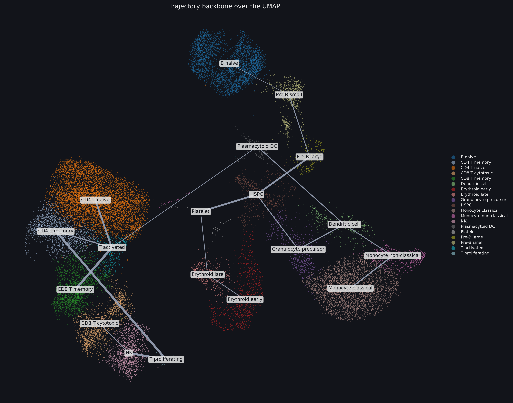</a><br><sub>Spanning tree on the UMAP: the lymphoid block hangs on one invented edge</sub></td>
</tr></table>

<table><tr>
<td width="50%" valign="top"><a href="figures/trajectory/trajectory_report/trajectory_report_pseudotime_by_celltype.png">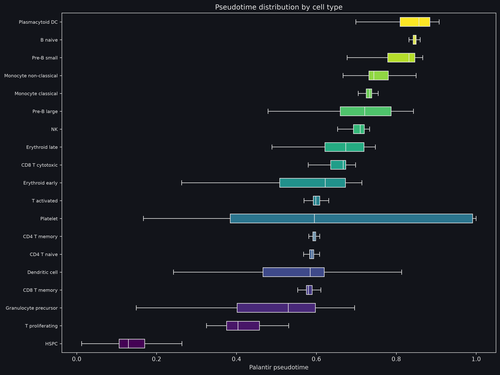</a><br><sub>Palantir pseudotime per cell type: HSPC first, mature lymphoid mid-axis</sub></td>
<td width="50%" valign="top"><a href="figures/trajectory/trajectory_report/trajectory_report_fate_matrix.png">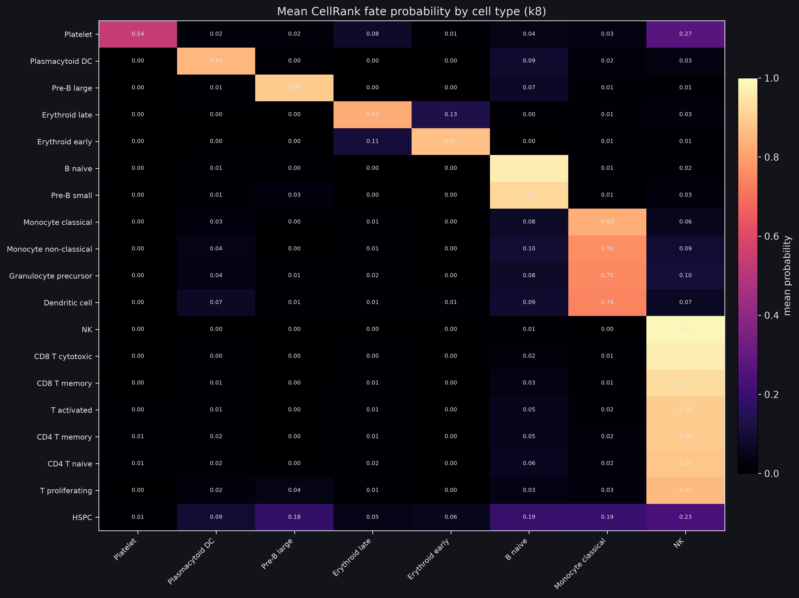</a><br><sub>CellRank fate probability per cell type: seven mature labels go to one "NK" basin</sub></td>
</tr></table>

**What works**

- The root is unambiguous: HSPC median pseudotime 0.13, the next population
  0.40. Two different HSPC root cells give identical orderings (Spearman 1.00).
- Three maturation series come out in order without labels: granulocyte
  precursor → classical → non-classical monocyte; Pre-B large → Pre-B small →
  B naive; erythroid early → late.
- HSPC multipotency is measured: fate entropy 0.80, top fate only 0.34, spread
  over six lineages. Entropy ranks every population by developmental potential.
- The monocyte lineage passes every test: bin composition (precursor →
  classical → non-classical), gene order (LYZ → S100A8/9 → CD14/FCN1 → mature
  markers) and velocity direction.
- Erythroid gene order is causal: GATA1 and KLF1 peak before the haem enzymes,
  membrane proteins and globins they control.
- Four terminal states are confirmed by Palantir and CellRank, which share only
  the expression matrix (correlation 0.94–0.98).

<table><tr>
<td width="50%" valign="top"><a href="figures/trajectory/gene_trends/gene_trends_monocyte_classical.png">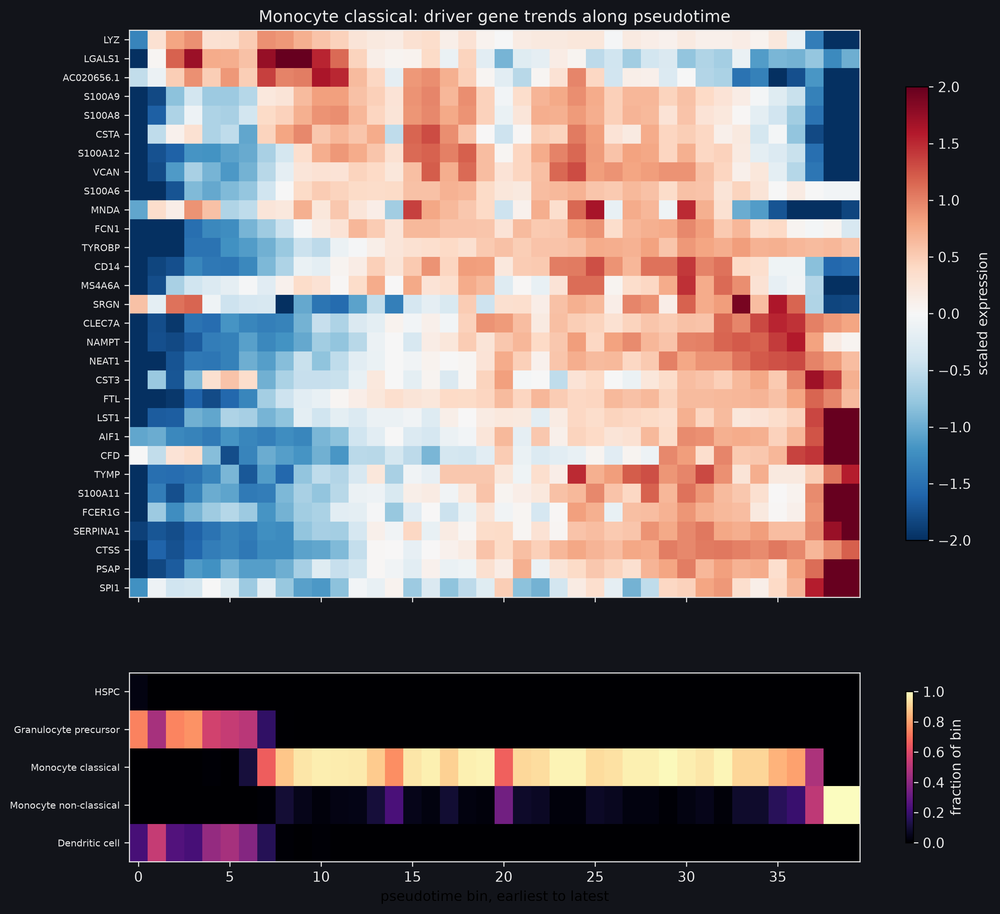</a><br><sub>Monocyte lineage: genes in order, cell labels sorted along pseudotime</sub></td>
<td width="50%" valign="top"><a href="figures/trajectory/gene_trends/gene_trends_erythroid_early.png">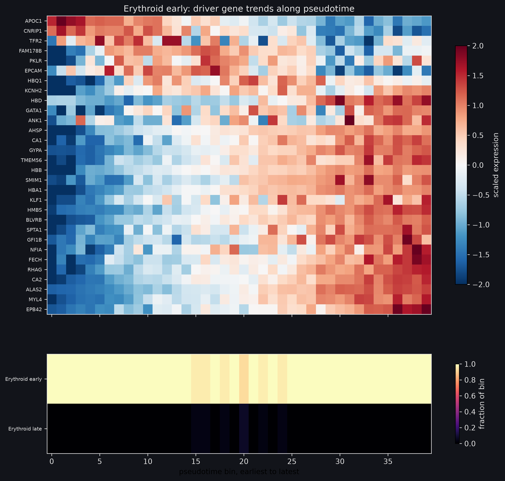</a><br><sub>Erythroid lineage: GATA1 and KLF1 before haem and globin genes</sub></td>
</tr></table>

**What does not**

- The seven mature lymphoid labels (56% of cells) sit mid-axis and are all
  assigned 0.86–0.99 to a single terminal named "NK". Its drivers are T-cell
  genes (IL32, CD3D/E); its "trajectory" is a gradient of cytotoxic programme
  strength. The same negative appears in PAGA topology, pseudotime, fate
  probabilities, the spanning tree (one invented bridge), the principal tree
  (a different invented bridge) and velocity.
- The diffusion map on scVI inverts the erythroid order and roots one run inside
  the monocytes, confirming PCA as the working basis.
- The principal tree anticorrelates with Palantir globally (−0.42): 18% of its
  length crosses empty space and it enters the myeloid lineage from the wrong
  end. It is used only as a topology check.

<table><tr>
<td width="50%" valign="top"><a href="figures/trajectory/gene_trends/gene_trends_nk.png">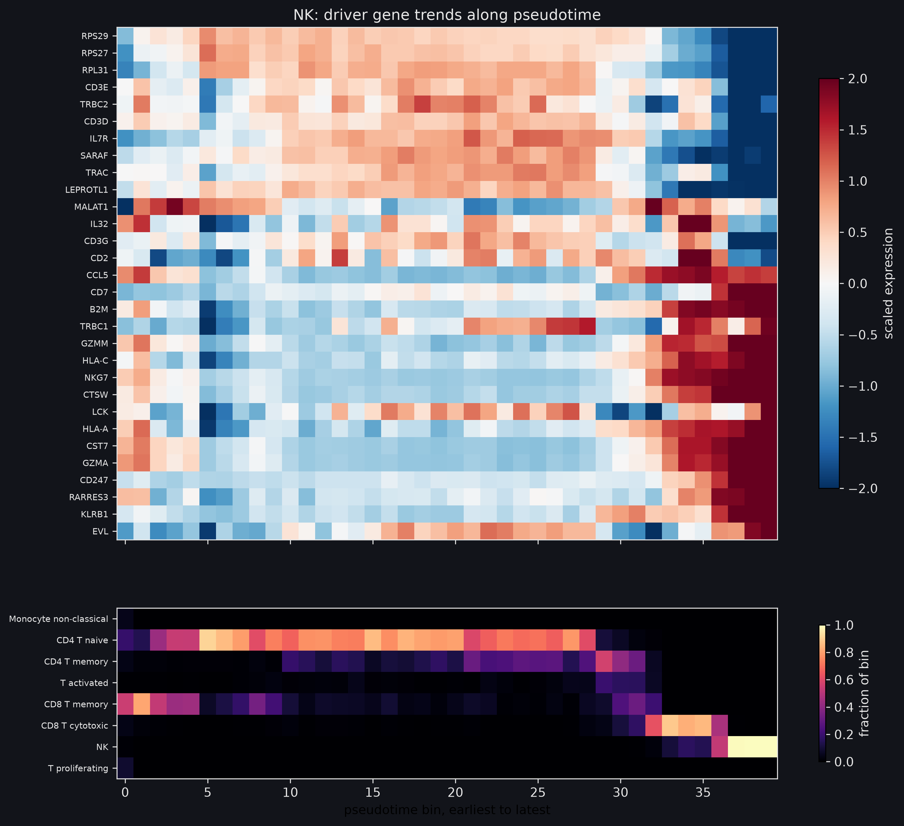</a><br><sub>The "NK" lineage: naive CD4 T → CD8 → NK, a cytotoxic gradient, not development</sub></td>
<td width="50%" valign="top"><a href="figures/trajectory/principal_graph/principal_graph_umap.png">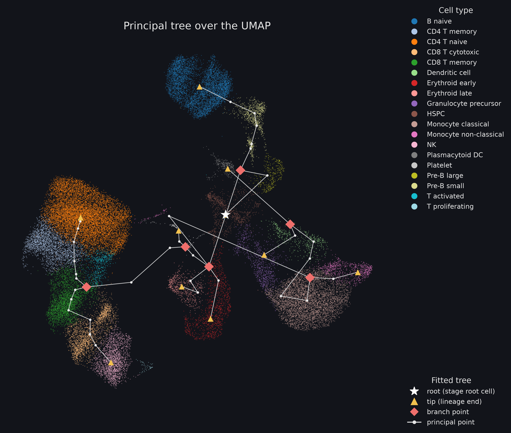</a><br><sub>Principal tree: long edges across empty space</sub></td>
</tr></table>

**RNA velocity** (direction of eight known differentiation steps, two models ×
two fits):

| step | correct | reversed | absent |
|---|---|---|---|
| Granulocyte precursor → Monocyte classical | 4 | 0 | 0 |
| Pre-B large → Pre-B small | 4 | 0 | 0 |
| Monocyte classical → non-classical | 3 | 0 | 1 |
| Pre-B small → B naive | 3 | 0 | 1 |
| Erythroid early → Erythroid late | 0 | **4** | 0 |
| HSPC → Pre-B large | 1 | 2 | 1 |
| HSPC → Erythroid early | 0 | 1 | 3 |
| HSPC → Granulocyte precursor | 0 | 1 | 3 |

- The erythroid reversal grows sevenfold when lymphoid cells are removed. Its
  defining genes (KLF1, GYPA, ALAS2, HBA1) cannot be fitted by the kinetic
  model, and late erythroid cells sit at the unspliced level of anucleate
  platelets — there is no signal to read.
- In the progenitor-only fit velocity points into HSPC from four lineages.
- Velocity confidence is highest in the reversed erythroid island (0.99). It
  measures agreement between neighbours, not correctness.
- Spliced/unspliced counts were recovered for all 38,430 cells; a lane offset of
  about ±10% in unspliced fraction was found within cell types, but velocity
  positions do not shift with the lane.

<table><tr>
<td width="50%" valign="top"><a href="figures/trajectory/velocity_progenitor/velocity_progenitor_stream_dynamical.png">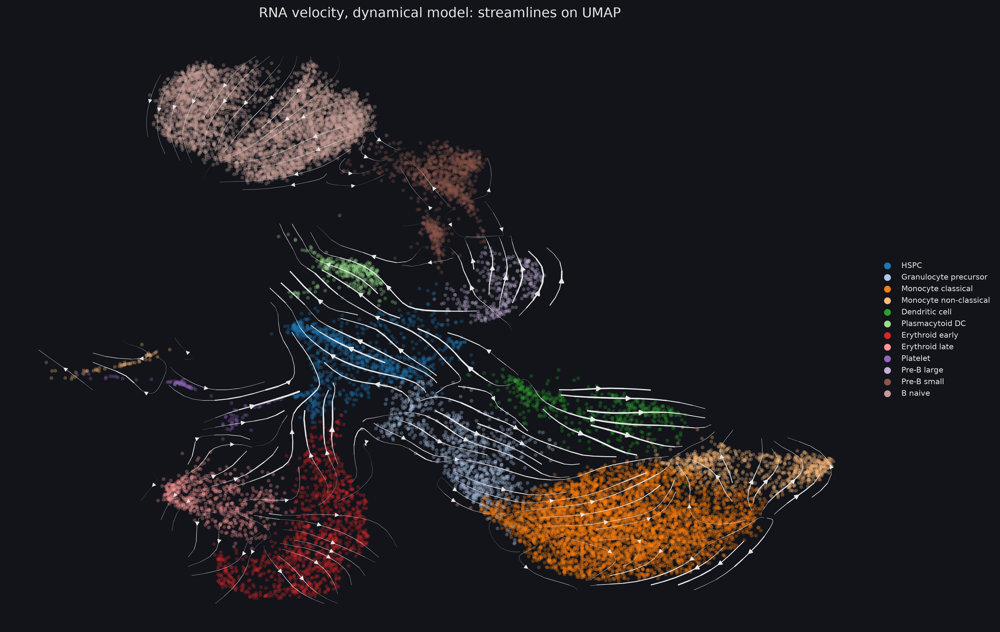</a><br><sub>Velocity streamlines, progenitor fit: monocyte flow correct, erythroid reversed</sub></td>
<td width="50%" valign="top"><a href="figures/trajectory/velocity_progenitor/velocity_progenitor_paga_stochastic.png">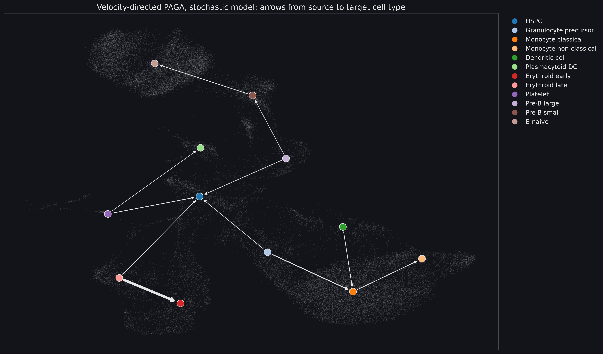</a><br><sub>Velocity-directed PAGA: arrows point into HSPC</sub></td>
</tr></table>

<table><tr>
<td width="50%" valign="top"><a href="figures/trajectory/velocity_scvelo/velocity_scvelo_stream_dynamical.png">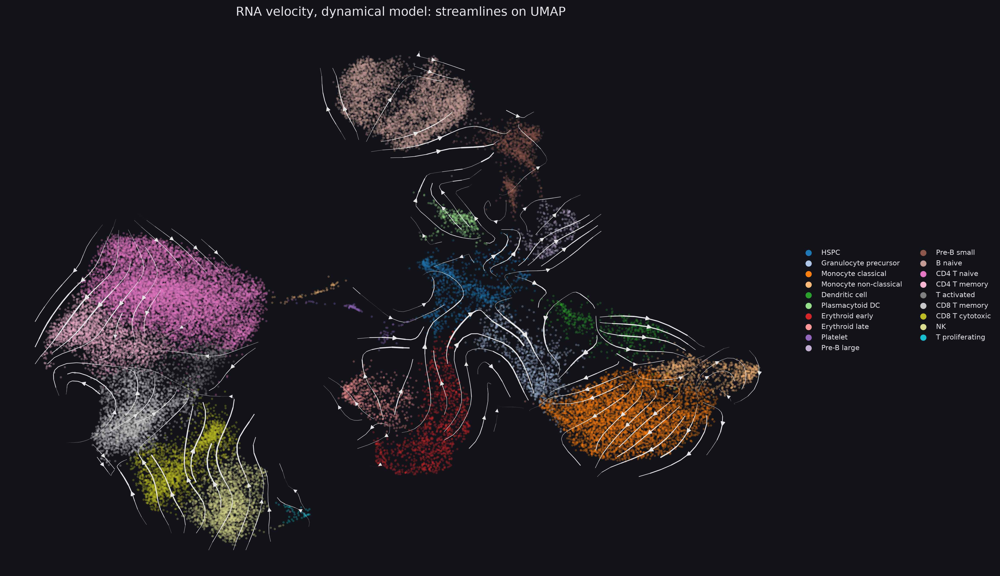</a><br><sub>Whole-sample velocity: strongest, and backwards, in the lymphoid block</sub></td>
<td width="50%" valign="top"><a href="figures/trajectory/velocity_counts/velocity_counts_lane_unspliced.png">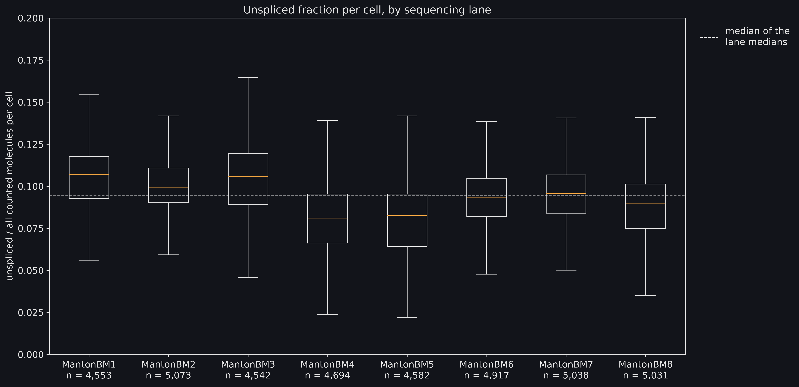</a><br><sub>Unspliced fraction per lane</sub></td>
</tr></table>

All figures: [`figures/trajectory/`](figures/trajectory/) · tables: [`results/trajectory/`](results/trajectory/)

### 4. Cell-cell communication

LIANA consensus ranking (seven scoring methods) with two resources, `consensus`
and `cellphonedb`, a method comparison, a per-donor rerun, pathway mapping and
non-negative matrix factorisation of signalling programmes.

<table><tr>
<td width="50%" valign="top"><a href="figures/cell_cell_communication/cell_communication_report/cell_communication_report_circle.png">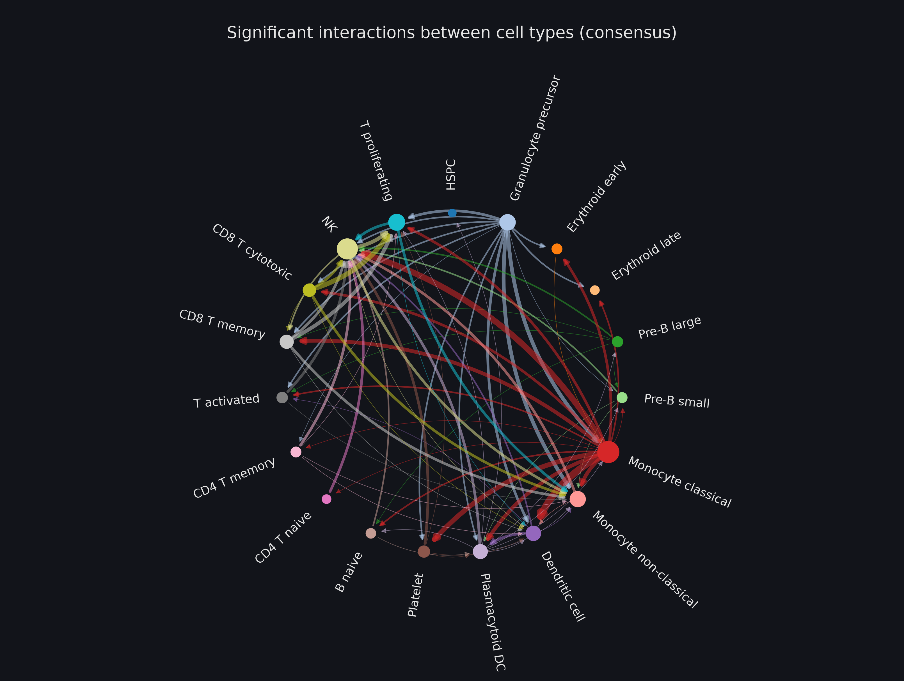</a><br><sub>Circle plot: significant interactions between cell types (edge width = count, colour = sender)</sub></td>
<td width="50%" valign="top"><a href="figures/cell_cell_communication/cell_communication_report/cell_communication_report_chord.png">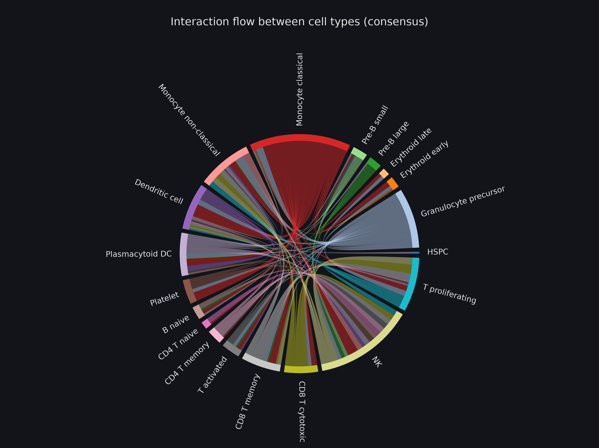</a><br><sub>Chord diagram of the same interaction flow</sub></td>
</tr></table>

Edges in the circle, chord, heatmap and hierarchy figures are weighted by the
number of significant interactions, not by a communication probability (LIANA
gives none). A thick edge means many annotated ligand-receptor pairs matched.

<table><tr>
<td width="50%" valign="top"><a href="figures/cell_cell_communication/cell_communication_report/cell_communication_report_heatmap.png">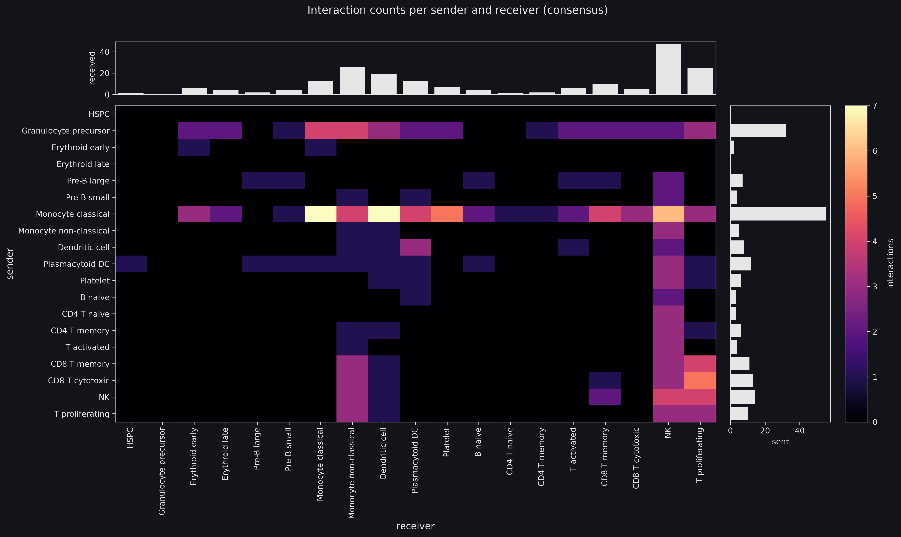</a><br><sub>Significant interactions per sender and receiver</sub></td>
<td width="50%" valign="top"><a href="figures/cell_cell_communication/cell_communication_report/cell_communication_report_dotplot.png">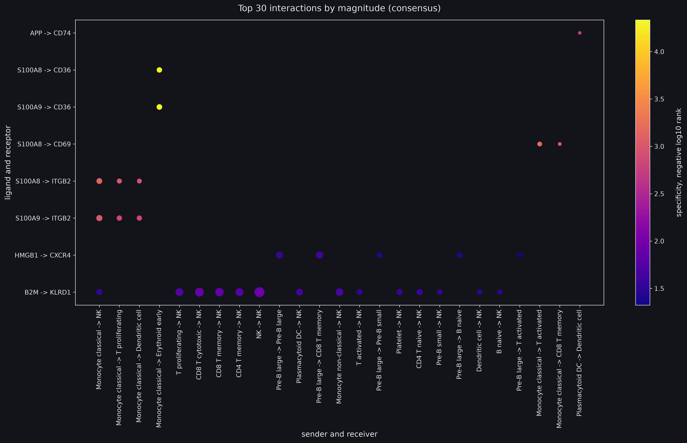</a><br><sub>Top interactions: the most frequent is the least specific</sub></td>
</tr></table>

<table><tr>
<td width="50%" valign="top"><a href="figures/cell_cell_communication/lr_donors/lr_donors_reproducibility_consensus.png">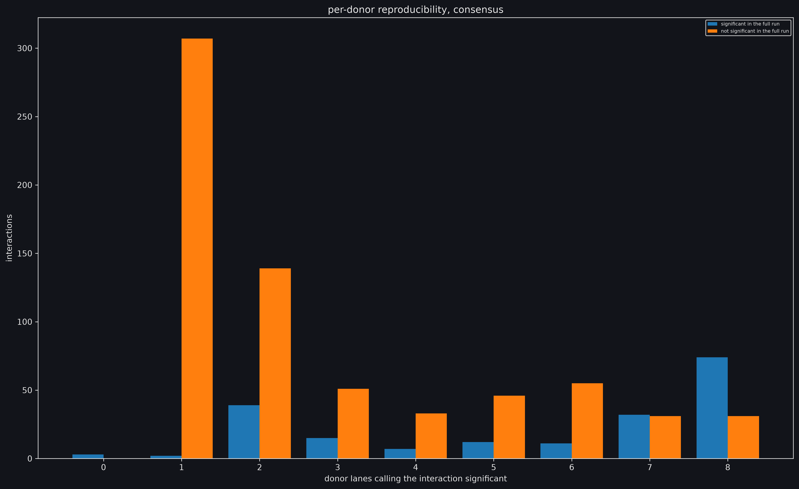</a><br><sub>Interactions by number of donors calling them</sub></td>
<td width="50%" valign="top"><a href="figures/cell_cell_communication/lr_methods/lr_methods_agreement_consensus.png">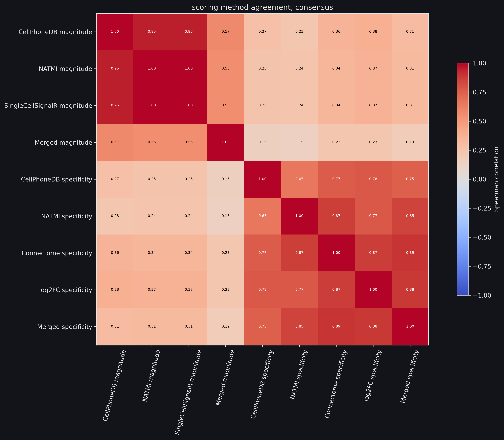</a><br><sub>Agreement between the seven scoring methods</sub></td>
</tr></table>

- 195 interactions are significant with `consensus`, 20 with `cellphonedb`;
  14 are shared. The shared core is APP → CD74 from plasmacytoid DCs,
  TNFSF13B (BAFF) → HLA-DPB1 into dendritic cells, and PF4 → CXCR3 from
  platelets.
- Two ligand families carry 80% of the result: HLA class I/B2M into
  NK-restricted receptors (true, but every cell expresses the ligand) and
  S100A8/A9/A12 from monocytes (the top marker genes of that label). Sender and
  receiver counts measure annotated marker loudness, not signalling.
- "Seven methods" are two measurements: two magnitude scores rank identically
  (Spearman 0.9999999999), and the CellPhoneDB permutation p-value is 0 for 64%
  of all tested pairs.
- Per donor, 74 of 195 interactions reproduce in all eight donors and a single
  donor reports 307 interactions found nowhere else. 31 interactions found by
  every donor are missed by the pooled run, all just above the cutoff and mostly
  into T subsets competing against the 10,765-cell CD4 T naive label.
- The donor split exposed T activated as 91% one donor; nothing before this
  stage split data by donor.
- Sending and receiving are nearly independent per cell type: Monocyte
  classical is the largest net sender (55 sent, 13 received), NK the largest
  net receiver (14 sent, 47 received), and Granulocyte precursor sends 32
  while receiving none. HSPC sends nothing and receives one interaction.

<table><tr>
<td width="50%" valign="top"><a href="figures/cell_cell_communication/cell_communication_report/cell_communication_report_sources_targets.png">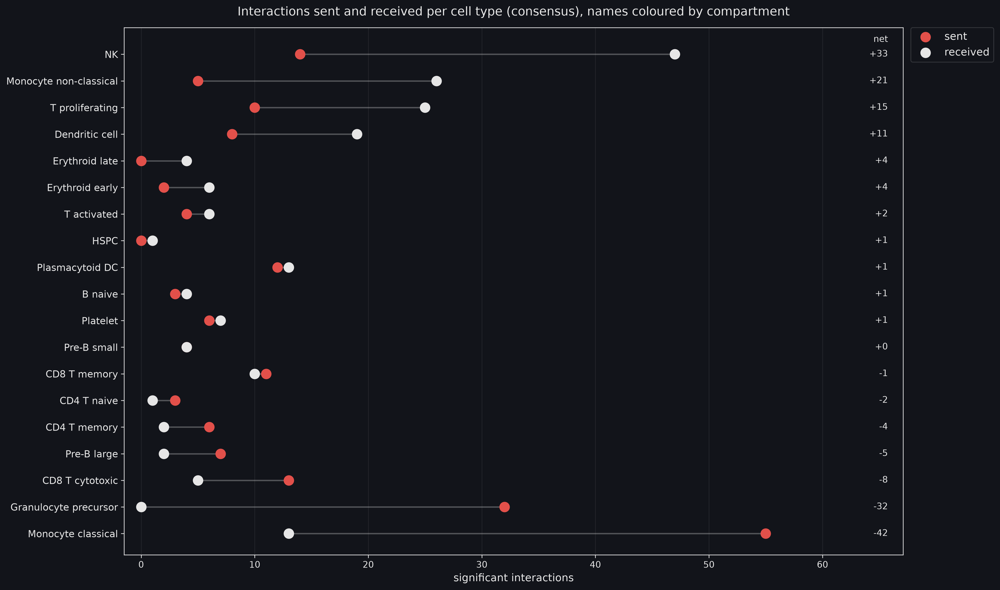</a><br><sub>Interactions sent and received per cell type, ordered by the difference</sub></td>
<td width="50%" valign="top"><a href="figures/cell_cell_communication/cell_communication_report/cell_communication_report_resource_overlap.png">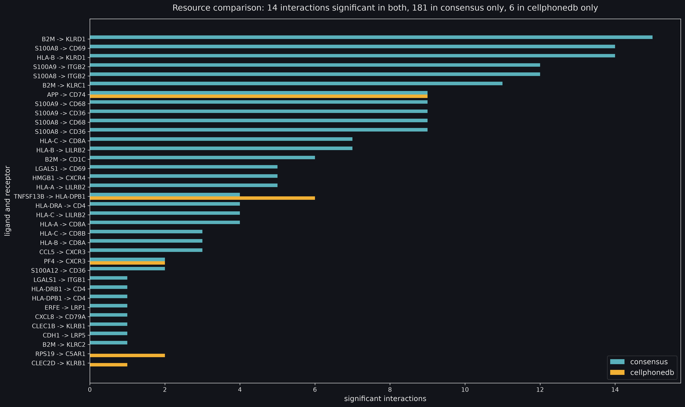</a><br><sub>consensus against cellphonedb: 14 shared, 181 and 6 unique</sub></td>
</tr></table>

- The developing compartment receives 17 of 195 interactions, through two
  channels only: S100 alarmins into erythroid CD36, and APP → CD74.

<table><tr>
<td width="50%" valign="top"><a href="figures/cell_cell_communication/cell_communication_report/cell_communication_report_hierarchy.png">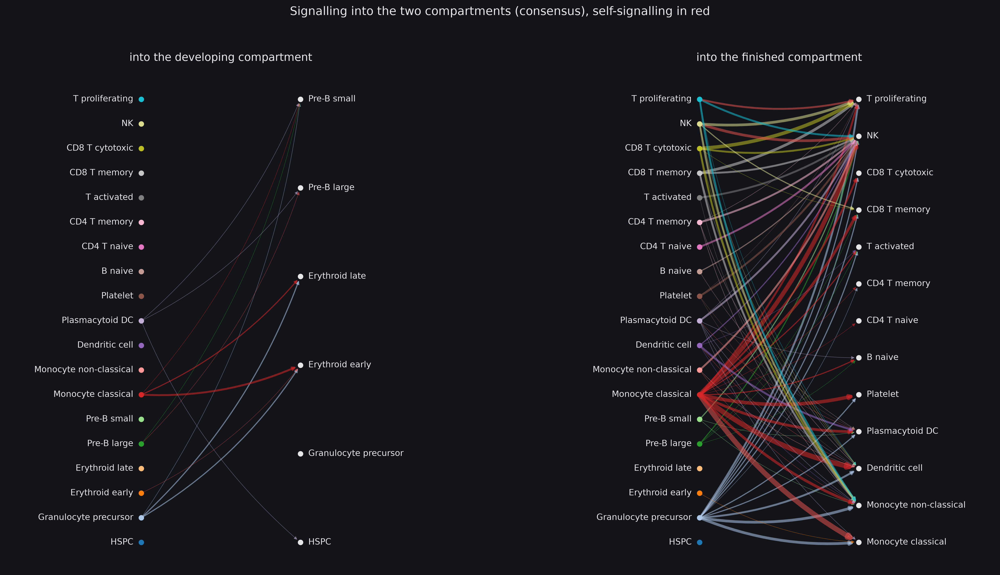</a><br><sub>Signalling into the developing (left) and finished (right) compartments</sub></td>
<td width="50%" valign="top"><a href="figures/cell_cell_communication/lr_patterns/lr_patterns_programs.png">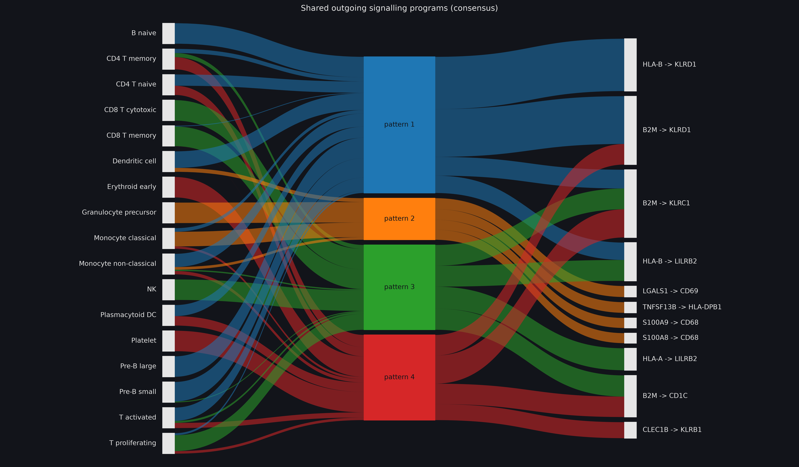</a><br><sub>Shared sending programmes from matrix factorisation</sub></td>
</tr></table>

All figures: [`figures/cell_cell_communication/`](figures/cell_cell_communication/) · tables: [`results/cell_cell_communication/`](results/cell_cell_communication/)

### 5. Deconvolution of bulk RNA-seq

Scaden trained on 8,000 pseudobulk mixtures from six donors, tested on held-out
mixtures from the other two donors, then on real sorted bulk RNA-seq. Scaden was
reimplemented in PyTorch (identical predictions with Scaden's weights, largest
difference about 1e-6; about 13× faster on GPU) to test training settings over
five seeds.

**Held-out pseudobulk** (realistic donor-composition mixtures, median per-label
concordance correlation, CCC):

| training | labels | lineage groups |
|---|---|---|
| Scaden default (5,000 steps) | 0.40 | 0.35 |
| full shuffle, 20,000 steps | 0.57 | 0.58 |

<table><tr>
<td width="50%" valign="top"><a href="figures/deconvolution/pseudobulk_score/pseudobulk_score_scaden_label_scatter.png">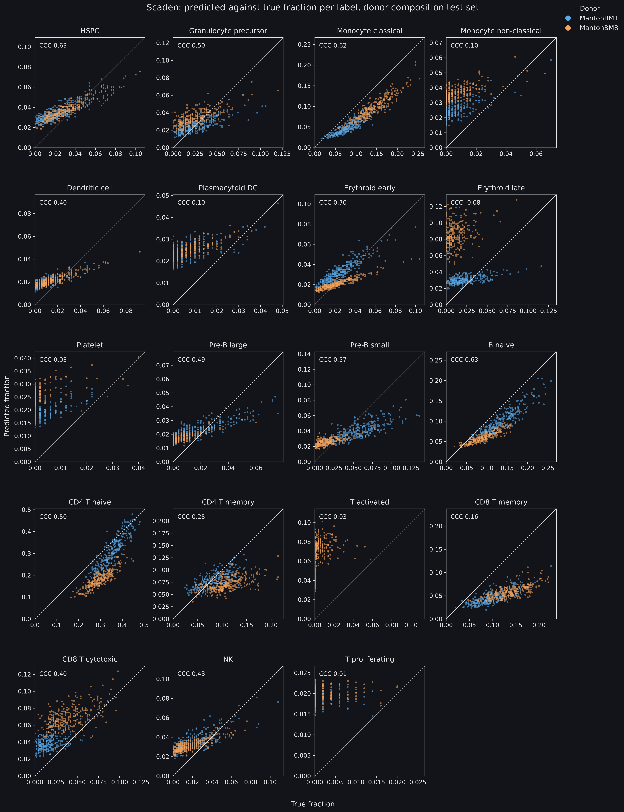</a><br><sub>Scaden on held-out donors: predicted against true share per label</sub></td>
<td width="50%" valign="top"><a href="figures/deconvolution/variant_score/variant_score_labels.png">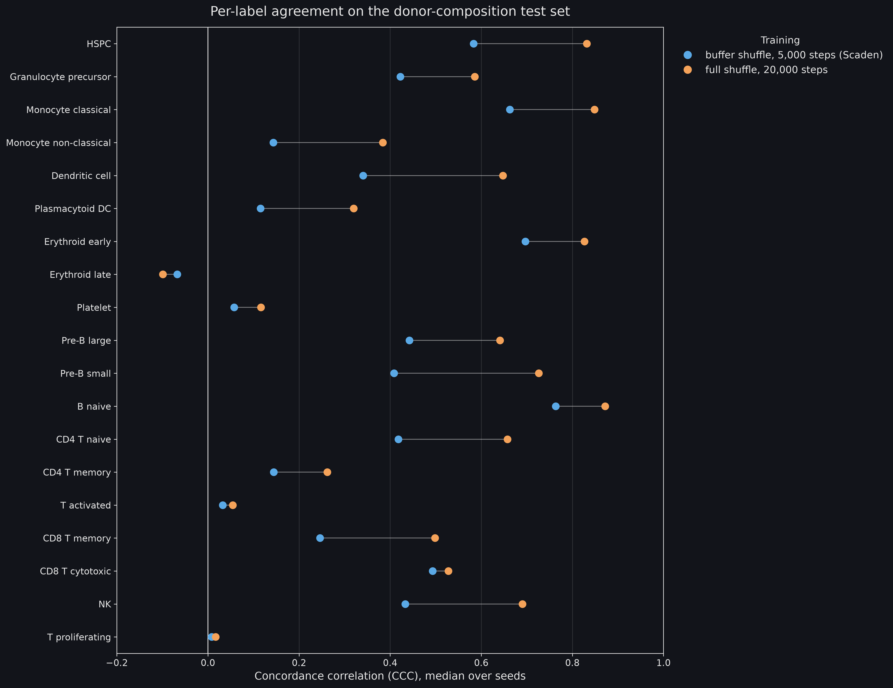</a><br><sub>Per-label agreement: Scaden default against 20,000 steps</sub></td>
</tr></table>

<table><tr>
<td width="50%" valign="top"><a href="figures/deconvolution/variant_score/variant_score_label_trend.png">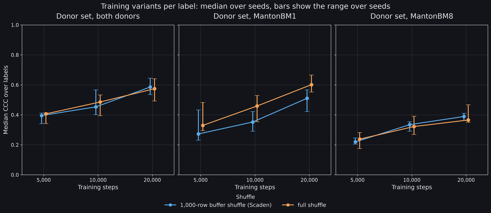</a><br><sub>Agreement against training length, five seeds</sub></td>
<td width="50%" valign="top"><a href="figures/deconvolution/scaden_torch_loss/scaden_torch_loss_last_passes.png">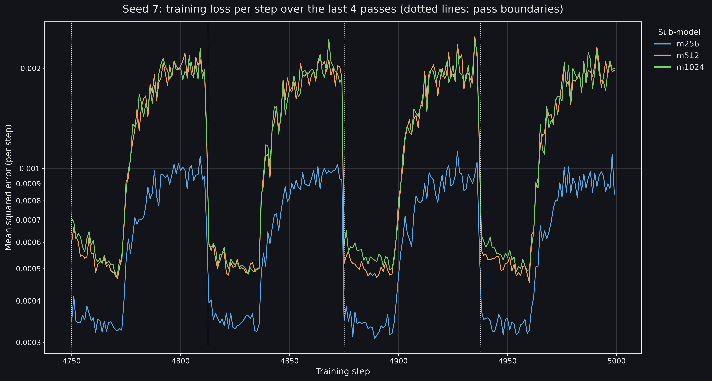</a><br><sub>Training loss per step: Scaden alternates between mixture types</sub></td>
</tr></table>

- Scaden ranks samples well but compresses the scale (median Pearson r 0.77
  against CCC 0.40): large populations are under-predicted and absent ones never
  fall below about 2%.
- Training length is the main lever; Scaden's default stops while the loss is
  still falling. Fourteen of 19 labels gain at least 0.1.
- Four labels do not gain with training — T activated, T proliferating,
  Platelet, Erythroid late — and are limited by their data; CD8 T cytotoxic
  gains only 0.04.
- One held-out donor fails in a specific way: its T cells carry the strongest
  immediate-early stress signature of all eight donors and are read as
  "T activated". Ambient haemoglobin was tested and ruled out.

<a href="figures/deconvolution/donor_diagnostics/donor_diagnostics_activation.png">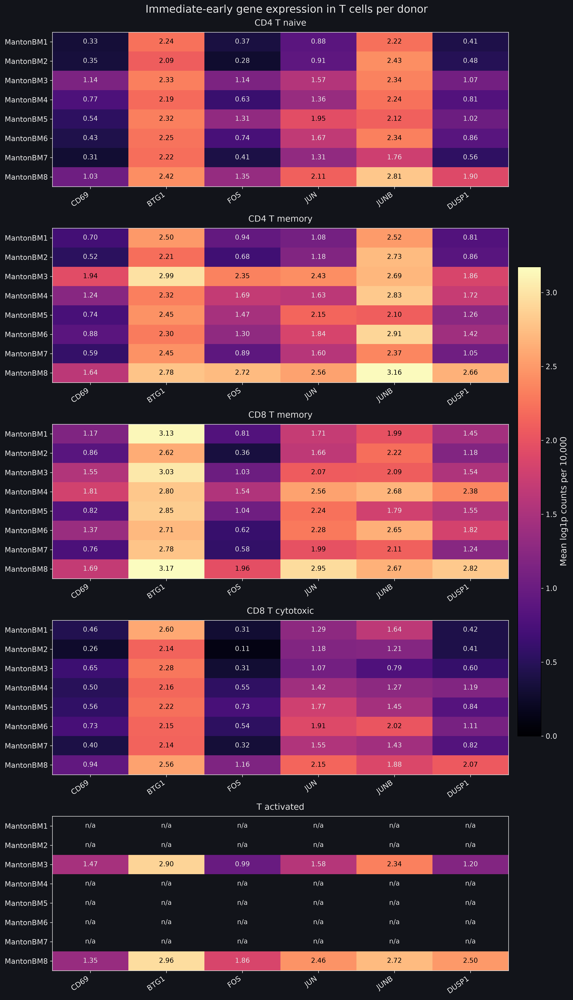</a><br><sub>Immediate-early genes in T cells per donor: MantonBM8 highest</sub>
- Single training runs differ enough (0.1–0.2 CCC per label) that variants were
  compared only as five-seed medians.

**Real bulk** (GSE74246; 49 sorted samples and 500 mixtures of their profiles,
five-seed ensemble):

<table><tr>
<td width="50%" valign="top"><a href="figures/deconvolution/bulk_score/bulk_score_pure_counts.png">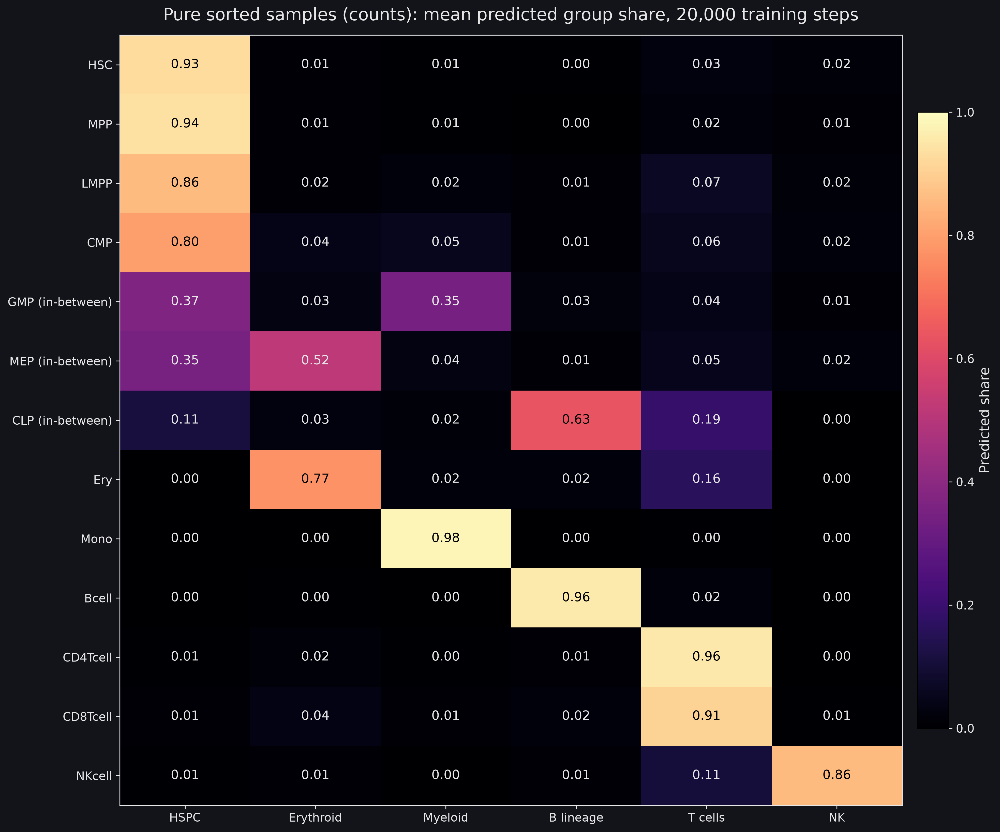</a><br><sub>Sorted bulk samples: predicted share per lineage</sub></td>
<td width="50%" valign="top"><a href="figures/deconvolution/bulk_score/bulk_score_mixtures_counts.png">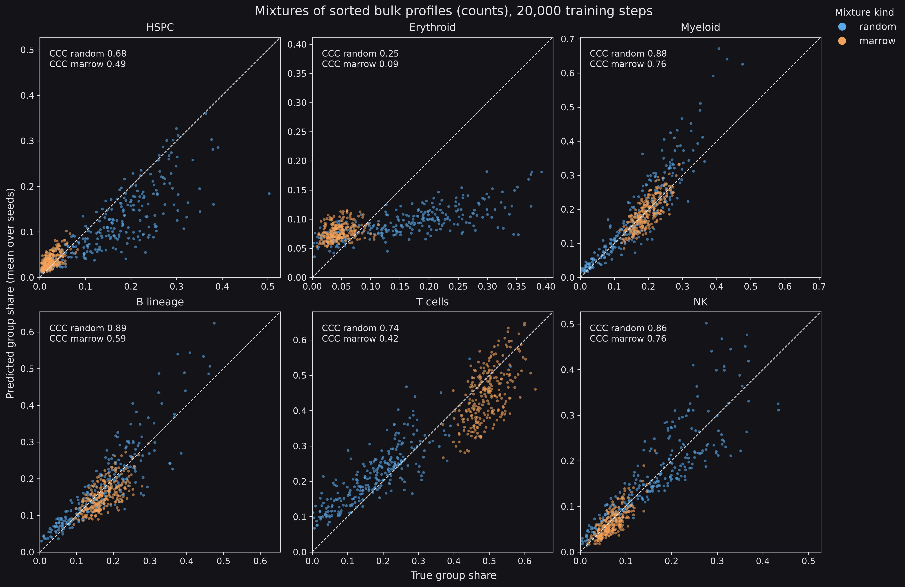</a><br><sub>Mixtures of real bulk profiles: predicted against true share</sub></td>
</tr></table>

| lineage | random mixtures CCC | marrow-like mixtures CCC |
|---|---|---|
| B lineage | 0.89 | 0.59 |
| Myeloid | 0.88 | 0.76 |
| NK | 0.86 | 0.76 |
| T cells | 0.74 | 0.42 |
| HSPC | 0.68 | 0.49 |
| Erythroid | 0.25 | 0.09 |

- Pure sorted samples receive 0.77–0.98 of their own lineage (median 0.92)
  despite a different library method and a third fewer shared genes.
  Intermediate progenitors (GMP, MEP, CLP) are split between the lineages they
  sit between.
- Averaging seeds is essential on real bulk: single runs carry lineage-wide
  offsets of up to ±0.2 that cancel in the ensemble.
- On marrow-like mixtures the overall composition is right (pooled CCC 0.97)
  but small sample-to-sample differences are not tracked.
- Gene-length correction made sorted profiles look more like the single cells
  and made the mixtures worse; raw counts were kept.

<a href="figures/deconvolution/corces_bulk/corces_bulk_correlation_counts.png">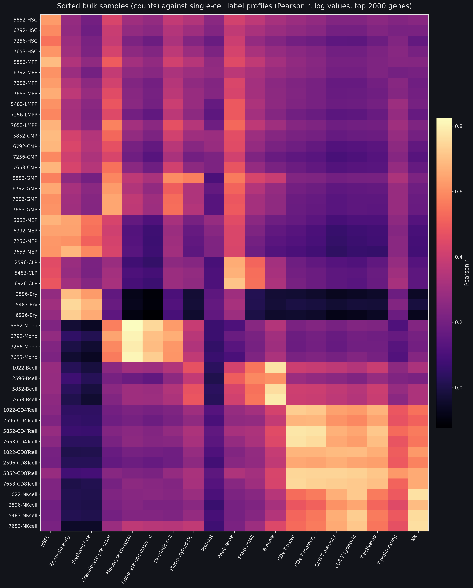</a><br><sub>Model-free check: each sorted sample against the single-cell label profiles</sub>

All figures: [`figures/deconvolution/`](figures/deconvolution/) · tables: [`results/deconvolution/`](results/deconvolution/)

## Conclusions across the project

- **Independent checks decided every important call.** Held-out donors,
  a second resource, a second method, raw counts and an external dataset each
  overturned at least one result that looked convincing on its own.
- **Splitting by donor matters even when batch effect is weak.** Cells of a type
  mix well across donors, but donor composition differs up to twelvefold and one
  label is a single-donor feature.
- **Small populations give the sharpest signals and the weakest support.**
  Platelets (103 cells) and proliferating T cells (47) produce the most specific
  interactions, the strongest drivers and the least stable edges.
- **Catalogue-based methods cannot see stem cells.** HSPC is central to the
  trajectory results and invisible to every gene-set, regulon and
  ligand-receptor catalogue.
- **Confidence scores are not evidence.** Velocity confidence, permutation
  p-values and pathway names each pointed the wrong way at least once.

## Limitations

- One dataset, eight donors, two held out for deconvolution.
- Three rare cell types (plasma cells, mast cells, macrophages) are absent from
  the 19 labels; the labels were fixed early by design.
- No real marrow bulk with measured composition was found; the real-bulk test
  uses sorted populations and in-silico mixtures (RNA shares, not cell shares).
- Velocity fit quality is low (median likelihood 0.05–0.08); the defining
  genes of the progenitor lineages do not fit the kinetic model.
- Settings outside the documented choices (learning rate, network size, number
  of signalling programmes) were not swept.

## Repository

```
src/        the code, one folder per stage, each with its own helper module
notebooks/  a walk-through of each stage's results, with figures and notes
results/    every table the scripts write, sorted by stage and script
figures/    every figure the scripts draw, sorted by stage and script
envs/       the package pins and full package lists to rebuild each env
data/       the annotated dataset (Git LFS); raw data not included
```

| stage | code | notebook |
|---|---|---|
| Load, QC, normalisation, clustering, annotation | `src/load_data`, `src/qc`, `src/preprocess`, `src/cluster`, `src/annotate` | [`scrna_bm_core_pipeline.ipynb`](notebooks/scrna_bm_core_pipeline.ipynb) |
| Dimensionality-reduction benchmark | `src/benchmark` | [`scrna_bm_dimensionality_reduction_benchmark.ipynb`](notebooks/scrna_bm_dimensionality_reduction_benchmark.ipynb) |
| Pathway analysis | `src/pathway` | [`scrna_bm_pathway_analysis.ipynb`](notebooks/scrna_bm_pathway_analysis.ipynb) |
| Trajectory and RNA velocity | `src/trajectory` | [`scrna_bm_trajectory_analysis.ipynb`](notebooks/scrna_bm_trajectory_analysis.ipynb) |
| Cell-cell communication | `src/cell_cell_communication` | [`scrna_bm_cell_cell_communication.ipynb`](notebooks/scrna_bm_cell_cell_communication.ipynb) |
| Deconvolution | `src/deconvolution` | [`scrna_bm_deconvolution.ipynb`](notebooks/scrna_bm_deconvolution.ipynb) |

**Environments** (conda; pins in `envs/constraints.txt`, full package lists in
`envs/`):

- `sc_core` (Python 3.13) — the main stack: scanpy, scVI, scVelo, CellRank,
  Palantir, LIANA, decoupler, gseapy, PyTorch.
- `sc_deconv` (Python 3.11) — Scaden and TensorFlow, kept separate.
- `rna_velo` (Python 3.11) — velocyto, for spliced and unspliced counts.

**Running.** Every script runs as a plain file from the repository root, for
example `python src/benchmark/emb_pca.py`. Later stages read only
`data/processed/bm_annotated.h5ad`:

```bash
git lfs install && git lfs pull
```

## References

- Hay SB, Ferchen K, Chetal K, Grimes HL, Salomonis N. The Human Cell Atlas bone
  marrow single-cell interactive web portal. *Exp Hematol* 2018.
- Corces MR et al. Lineage-specific and single-cell chromatin accessibility
  charts human hematopoiesis and leukemia evolution. *Nat Genet* 2016.
- Menden K et al. Deep learning-based cell composition analysis from tissue
  expression profiles (Scaden). *Sci Adv* 2020.

